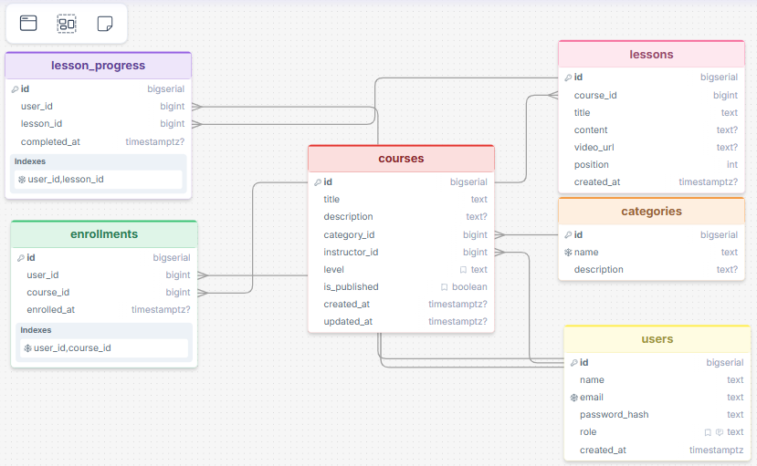
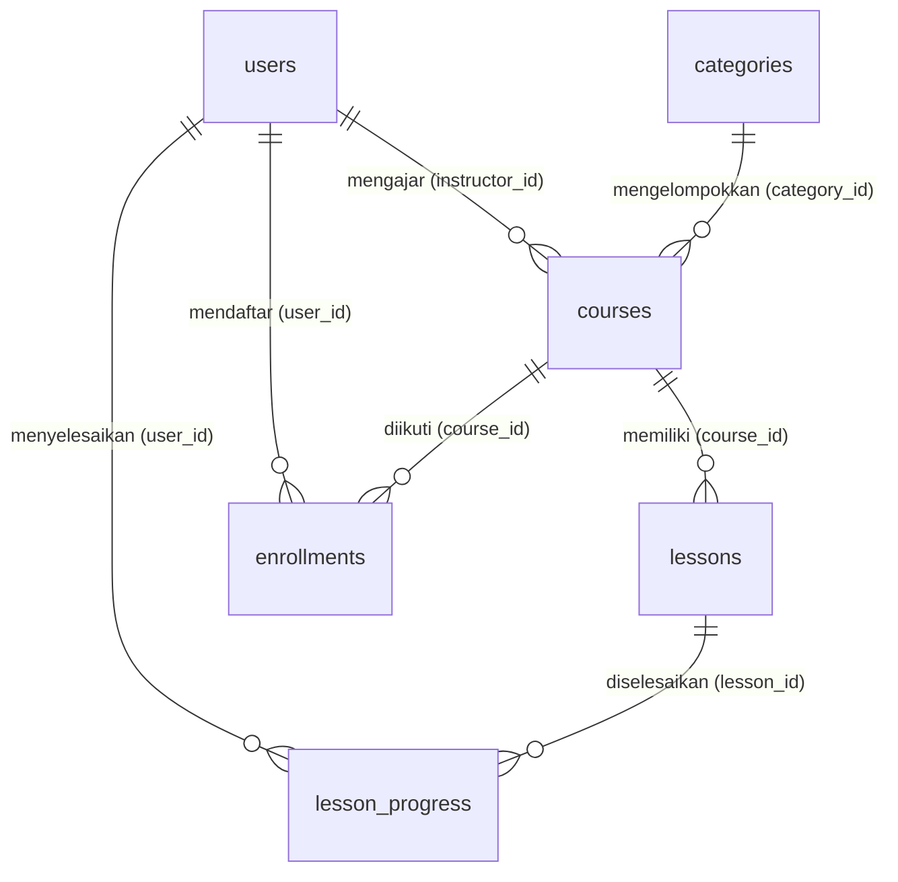

# SABDA LMS

**Daftar isi**

1. [Deskripsi Project](#1-deskripsi-project)
2. [ERD dan Skema Database](#2-erd-dan-skema-database)
3. [Link Deployment](#3-link-deployment)
4. [Dokumentasi Endpoint](#4-dokumentasi-endpoint)
5. [Cara Menjalankan Secara Lokal](#5-cara-menjalankan-secara-lokal)

---

## 1. Deskripsi Project

**SABDA LMS** adalah backend untuk platform belajar online. API ini menangani akun pengguna, kategori, kursus, pelajaran, pendaftaran kursus, dan pencatatan progres belajar. Sistem mempertemukan tiga jenis pengguna:

- **Student** mendaftar ke kursus, membaca pelajaran, menandai pelajaran selesai, dan melihat progres belajar.
- **Instructor** membuat kursus dan pelajaran, menerbitkan kursus, serta memantau progres siswanya.
- **Admin** mengelola kategori dan pengguna (mengubah role, menghapus akun), dan dapat mengelola semua kursus.

Registrasi publik selalu membuat akun `student`. Role `instructor` dan `admin` hanya bisa diberikan oleh admin.

| Komponen | Teknologi |
|----------|-----------|
| Bahasa dan framework | Python 3, Flask 3 |
| Database | Supabase (PostgreSQL) |
| Autentikasi | JWT (PyJWT) dan hash password scrypt (Werkzeug) |
| Deployment | Vercel (Python serverless function) |
| Frontend | HTML/CSS/JavaScript |

---

## 2. ERD dan Skema Database

Database memiliki **6 tabel** yang saling terhubung lewat foreign key. File sumber skema: [`database/schema.sql`](database/schema.sql). Versi dbdiagram.io: [`database/erd.dbml`](database/erd.dbml).

### 2.1 Gambar ERD



Diagram yang sama dalam bentuk teks (otomatis tampil di GitHub):



### 2.2 Daftar tabel dan relasi

| Tabel | Primary Key | Foreign Key | Relasi |
|-------|-------------|-------------|--------|
| `users` | `id` | - | Satu user (instructor) punya banyak `courses` |
| `categories` | `id` | - | Satu kategori punya banyak `courses` (one-to-many) |
| `courses` | `id` | `category_id`, `instructor_id` | Satu course punya banyak `lessons` |
| `lessons` | `id` | `course_id` | Dihapus otomatis saat course dihapus (cascade) |
| `enrollments` | `id` | `user_id`, `course_id` | **Pivot many-to-many** antara `users` dan `courses` |
| `lesson_progress` | `id` | `user_id`, `lesson_id` | **Pivot many-to-many** antara `users` dan `lessons` |

### 2.3 Aturan integritas data

- `unique(user_id, course_id)` pada `enrollments` dan `unique(user_id, lesson_id)` pada `lesson_progress` mencegah data ganda.
- Kategori dan pengajar yang masih dipakai kursus **tidak bisa dihapus** (`on delete restrict`).
- Pelajaran dan pendaftaran **ikut terhapus** bersama kursusnya (`on delete cascade`).
- View `course_stats` menghitung jumlah pelajaran dan siswa per kursus.

---

## 3. Link Deployment

| Keterangan | URL |
|------------|-----|
| Aplikasi dan API (Vercel) | `https://sabda-eta.vercel.app/` |
| Base URL API | `https://sabda-eta.vercel.app/api` |
| Cek status server dan database | `https://sabda-eta.vercel.app/api/health` |
| Repository GitHub | `https://github.com/AlgorithmShark/SABDA_LMS` |

---

## 4. Dokumentasi Endpoint

Total **33 endpoint**, memakai method `GET`, `POST`, `PUT`, `PATCH`, dan `DELETE`. Resource dengan **CRUD lengkap**: `categories`, `courses`, dan `lessons`.

### 4.1 Ketentuan umum

- Semua request dan response memakai format **JSON**. Semua endpoint berawalan `/api`.
- Autentikasi memakai header `Authorization: Bearer <token>`. Token didapat dari endpoint **Register** atau **Login**.
- Response sukses berbentuk `{"message": "...", "data": ...}`. Daftar yang berpaginasi menambahkan `"meta": {"page", "per_page", "total"}`.
- Response error selalu berbentuk `{"error": "pesan yang jelas"}`.
- `PUT` mengganti seluruh data, sedangkan `PATCH` hanya mengubah sebagian field.

| Status | Arti |
|--------|------|
| `200` OK / `201` Created | Berhasil (`201` untuk data baru) |
| `400` | Input tidak valid atau field wajib kosong |
| `401` | Token tidak ada, tidak valid, atau kedaluwarsa |
| `403` | Role tidak berhak atau bukan pemilik data |
| `404` | Data atau endpoint tidak ditemukan |
| `409` | Konflik: data duplikat atau masih terhubung dengan data lain |
| `500` / `503` | Kesalahan server / database tidak dapat dijangkau |

### 4.2 Ringkasan endpoint

| No | Method | Endpoint | Nama | Akses |
|----|--------|----------|------|-------|
| 1 | `GET` | `/api/health` | Health Check | Publik |
| 2 | `GET` | `/api/stats` | Statistik Publik | Publik |
| 3 | `POST` | `/api/auth/register` | Register | Publik |
| 4 | `POST` | `/api/auth/login` | Login | Publik |
| 5 | `GET` | `/api/auth/me` | Profil Saya | Login (semua role) |
| 6 | `PATCH` | `/api/auth/me` | Ubah Profil | Login (semua role) |
| 7 | `GET` | `/api/categories` | Daftar Kategori | Publik |
| 8 | `GET` | `/api/categories/{id}` | Detail Kategori | Publik |
| 9 | `POST` | `/api/categories` | Tambah Kategori | Role: admin |
| 10 | `PUT` | `/api/categories/{id}` | Ubah Kategori | Role: admin |
| 11 | `DELETE` | `/api/categories/{id}` | Hapus Kategori | Role: admin |
| 12 | `GET` | `/api/courses` | Daftar Kursus | Publik |
| 13 | `GET` | `/api/courses/{id}` | Detail Kursus | Publik |
| 14 | `POST` | `/api/courses` | Tambah Kursus | Role: instructor, admin |
| 15 | `PUT` | `/api/courses/{id}` | Ubah Kursus (PUT) | Role: instructor, admin |
| 16 | `PATCH` | `/api/courses/{id}` | Ubah Sebagian Kursus (PATCH) | Role: instructor, admin |
| 17 | `DELETE` | `/api/courses/{id}` | Hapus Kursus | Role: instructor, admin |
| 18 | `GET` | `/api/courses/{id}/lessons` | Daftar Pelajaran Kursus | Login (semua role) |
| 19 | `POST` | `/api/courses/{id}/lessons` | Tambah Pelajaran | Role: instructor, admin |
| 20 | `GET` | `/api/lessons/{id}` | Detail Pelajaran | Login (semua role) |
| 21 | `PUT` | `/api/lessons/{id}` | Ubah Pelajaran (PUT) | Role: instructor, admin |
| 22 | `PATCH` | `/api/lessons/{id}` | Ubah Sebagian Pelajaran (PATCH) | Role: instructor, admin |
| 23 | `DELETE` | `/api/lessons/{id}` | Hapus Pelajaran | Role: instructor, admin |
| 24 | `POST` | `/api/courses/{id}/enroll` | Daftar ke Kursus | Role: student |
| 25 | `DELETE` | `/api/courses/{id}/enroll` | Keluar dari Kursus | Role: student |
| 26 | `GET` | `/api/enrollments/me` | Kursus Saya | Login (semua role) |
| 27 | `GET` | `/api/courses/{id}/students` | Siswa Terdaftar | Role: instructor, admin |
| 28 | `POST` | `/api/lessons/{id}/complete` | Tandai Pelajaran Selesai | Role: student |
| 29 | `DELETE` | `/api/lessons/{id}/complete` | Batalkan Tanda Selesai | Role: student |
| 30 | `GET` | `/api/users` | Daftar Pengguna | Role: admin |
| 31 | `GET` | `/api/users/{id}` | Detail Pengguna | Role: admin |
| 32 | `PATCH` | `/api/users/{id}` | Ubah Pengguna | Role: admin |
| 33 | `DELETE` | `/api/users/{id}` | Hapus Pengguna | Role: admin |

### 4.3 Detail endpoint

#### Umum

##### 1. Health Check

- **Method** : `GET`
- **URL** : `https://nama-project.vercel.app/api/health`
- **Deskripsi** : Memeriksa server dan koneksi database. Akses: Publik.
- **Headers** : -
- **Response Sukses (200)** :

```json
{
  "data": {
    "status": "ok",
    "database": "up"
  }
}
```

- **Response Error (503)** : `{"status": "error", "database": "down"}`

##### 2. Statistik Publik

- **Method** : `GET`
- **URL** : `https://nama-project.vercel.app/api/stats`
- **Deskripsi** : Jumlah kursus terbit, pelajaran, dan siswa. Akses: Publik.
- **Headers** : -
- **Response Sukses (200)** :

```json
{
  "data": {
    "courses": 3,
    "lessons": 8,
    "students": 1
  }
}
```

#### Auth

##### 3. Register

- **Method** : `POST`
- **URL** : `https://nama-project.vercel.app/api/auth/register`
- **Deskripsi** : Mendaftar akun baru (role otomatis student). Akses: Publik.
- **Headers** : `Content-Type: application/json`
- **Request Body** :

```json
{
  "name": "Budi Siswa",
  "email": "budi@example.com",
  "password": "rahasia123"
}
```

- **Response Sukses (201)** :

```json
{
  "message": "Registrasi berhasil",
  "data": {
    "user": {
      "id": 4,
      "name": "Budi Siswa",
      "email": "budi@example.com",
      "role": "student",
      "created_at": "2026-10-25T08:00:00+00:00"
    },
    "token": "eyJhbGciOiJIUzI1NiIs..."
  }
}
```

- **Response Error (400)** : `{"error": "Format email tidak valid"}`
- **Response Error (409)** : `{"error": "Email sudah terdaftar"}`

##### 4. Login

- **Method** : `POST`
- **URL** : `https://nama-project.vercel.app/api/auth/login`
- **Deskripsi** : Login dan mendapatkan JWT (berlaku 24 jam). Akses: Publik.
- **Headers** : `Content-Type: application/json`
- **Request Body** :

```json
{
  "email": "budi@example.com",
  "password": "rahasia123"
}
```

- **Response Sukses (200)** :

```json
{
  "message": "Login berhasil",
  "data": {
    "user": {
      "id": 4,
      "name": "Budi Siswa",
      "email": "budi@example.com",
      "role": "student",
      "created_at": "2026-10-25T08:00:00+00:00"
    },
    "token": "eyJhbGciOiJIUzI1NiIs..."
  }
}
```

- **Response Error (400)** : `{"error": "Field password wajib diisi"}`
- **Response Error (401)** : `{"error": "Email atau password salah"}`

##### 5. Profil Saya

- **Method** : `GET`
- **URL** : `https://nama-project.vercel.app/api/auth/me`
- **Deskripsi** : Data akun yang sedang login. Akses: Login (semua role).
- **Headers** : `Authorization: Bearer <token>`
- **Response Sukses (200)** :

```json
{
  "data": {
    "id": 4,
    "name": "Budi Siswa",
    "email": "budi@example.com",
    "role": "student",
    "created_at": "2026-10-25T08:00:00+00:00"
  }
}
```

- **Response Error (401)** : `{"error": "Token autentikasi diperlukan"}`

##### 6. Ubah Profil

- **Method** : `PATCH`
- **URL** : `https://nama-project.vercel.app/api/auth/me`
- **Deskripsi** : Ubah nama dan/atau password (wajib menyertakan current_password). Akses: Login (semua role).
- **Headers** : `Content-Type: application/json` | `Authorization: Bearer <token>`
- **Request Body** :

```json
{
  "name": "Budi Santoso",
  "current_password": "rahasia123",
  "new_password": "passwordbaru123"
}
```

- **Response Sukses (200)** :

```json
{
  "message": "Profil berhasil diperbarui",
  "data": {
    "id": 4,
    "name": "Budi Santoso",
    "email": "budi@example.com",
    "role": "student",
    "created_at": "2026-10-25T08:00:00+00:00"
  }
}
```

- **Response Error (401)** : `{"error": "Token autentikasi diperlukan"}`
- **Response Error (400)** : `{"error": "Password saat ini salah"}`

#### Kategori

##### 7. Daftar Kategori

- **Method** : `GET`
- **URL** : `https://nama-project.vercel.app/api/categories`
- **Deskripsi** : Semua kategori (urut nama). Akses: Publik.
- **Headers** : -
- **Response Sukses (200)** :

```json
{
  "data": [
    {
      "id": 1,
      "name": "Pemrograman",
      "description": "Belajar menulis kode"
    }
  ]
}
```

##### 8. Detail Kategori

- **Method** : `GET`
- **URL** : `https://nama-project.vercel.app/api/categories/1`
- **Deskripsi** : Satu kategori berdasarkan ID. Akses: Publik.
- **Headers** : -
- **Response Sukses (200)** :

```json
{
  "data": {
    "id": 1,
    "name": "Pemrograman",
    "description": "Belajar menulis kode"
  }
}
```

- **Response Error (404)** : `{"error": "Kategori tidak ditemukan"}`

##### 9. Tambah Kategori

- **Method** : `POST`
- **URL** : `https://nama-project.vercel.app/api/categories`
- **Deskripsi** : Menambah kategori baru. Khusus admin. Akses: Role: admin.
- **Headers** : `Content-Type: application/json` | `Authorization: Bearer <token>`
- **Request Body** :

```json
{
  "name": "Pemrograman",
  "description": "Belajar menulis kode"
}
```

- **Response Sukses (201)** :

```json
{
  "message": "Kategori berhasil ditambahkan",
  "data": {
    "id": 1,
    "name": "Pemrograman",
    "description": "Belajar menulis kode"
  }
}
```

- **Response Error (401)** : `{"error": "Token autentikasi diperlukan"}`
- **Response Error (403)** : `{"error": "Anda tidak memiliki akses ke resource ini"}`
- **Response Error (400)** : `{"error": "Field name wajib diisi"}`
- **Response Error (409)** : `{"error": "Data sudah ada (duplikat)"}`

##### 10. Ubah Kategori

- **Method** : `PUT`
- **URL** : `https://nama-project.vercel.app/api/categories/1`
- **Deskripsi** : Mengubah seluruh data kategori. Khusus admin. Akses: Role: admin.
- **Headers** : `Content-Type: application/json` | `Authorization: Bearer <token>`
- **Request Body** :

```json
{
  "name": "Pemrograman Web",
  "description": "HTML, CSS, JS"
}
```

- **Response Sukses (200)** :

```json
{
  "message": "Kategori berhasil diperbarui",
  "data": {
    "id": 1,
    "name": "Pemrograman Web",
    "description": "HTML, CSS, JS"
  }
}
```

- **Response Error (401)** : `{"error": "Token autentikasi diperlukan"}`
- **Response Error (403)** : `{"error": "Anda tidak memiliki akses ke resource ini"}`
- **Response Error (404)** : `{"error": "Kategori tidak ditemukan"}`

##### 11. Hapus Kategori

- **Method** : `DELETE`
- **URL** : `https://nama-project.vercel.app/api/categories/1`
- **Deskripsi** : Menghapus kategori. Khusus admin; gagal jika masih dipakai kursus. Akses: Role: admin.
- **Headers** : `Authorization: Bearer <token>`
- **Response Sukses (200)** :

```json
{
  "message": "Kategori berhasil dihapus"
}
```

- **Response Error (401)** : `{"error": "Token autentikasi diperlukan"}`
- **Response Error (403)** : `{"error": "Anda tidak memiliki akses ke resource ini"}`
- **Response Error (409)** : `{"error": "Data terhubung dengan data lain sehingga tidak dapat diproses"}`

#### Kursus

##### 12. Daftar Kursus

- **Method** : `GET`
- **URL** : `https://nama-project.vercel.app/api/courses?q=python&category_id=1&level=beginner&page=1&per_page=12`
- **Deskripsi** : Kursus terbit dengan pencarian judul (`q`), filter `category_id`, `level`, dan paginasi. Tambahkan `scope=mine` (instruktur/admin: kursus milik sendiri termasuk draf) atau `scope=all` (admin) dengan token. Akses: Publik.
- **Headers** : -
- **Response Sukses (200)** :

```json
{
  "data": [
    {
      "id": 1,
      "title": "Dasar Pemrograman Python",
      "description": "Mulai dari variabel hingga fungsi.",
      "category_id": 1,
      "instructor_id": 2,
      "level": "beginner",
      "is_published": true,
      "created_at": "2026-10-25T08:00:00+00:00",
      "updated_at": "2026-10-25T08:00:00+00:00",
      "category_name": "Pemrograman",
      "instructor_name": "Bu Sari Pengajar",
      "lesson_count": 3,
      "student_count": 1
    }
  ],
  "meta": {
    "page": 1,
    "per_page": 12,
    "total": 1
  }
}
```

- **Response Error (400)** : `{"error": "Field level harus salah satu dari: beginner, intermediate, advanced"}`

##### 13. Detail Kursus

- **Method** : `GET`
- **URL** : `https://nama-project.vercel.app/api/courses/1`
- **Deskripsi** : Detail kursus + daftar pelajaran (tanpa isi materi). Token opsional; bila siswa terdaftar, muncul status selesai per pelajaran. Akses: Publik.
- **Headers** : -
- **Response Sukses (200)** :

```json
{
  "data": {
    "id": 1,
    "title": "Dasar Pemrograman Python",
    "description": "Mulai dari variabel hingga fungsi.",
    "category_id": 1,
    "instructor_id": 2,
    "level": "beginner",
    "is_published": true,
    "created_at": "2026-10-25T08:00:00+00:00",
    "updated_at": "2026-10-25T08:00:00+00:00",
    "category_name": "Pemrograman",
    "instructor_name": "Bu Sari Pengajar",
    "lesson_count": 3,
    "student_count": 1,
    "lessons": [
      {
        "id": 1,
        "title": "Mengenal Python dan Variabel",
        "position": 1
      }
    ],
    "is_enrolled": false,
    "can_manage": false
  }
}
```

- **Response Error (404)** : `{"error": "Kursus tidak ditemukan"}`

##### 14. Tambah Kursus

- **Method** : `POST`
- **URL** : `https://nama-project.vercel.app/api/courses`
- **Deskripsi** : Membuat kursus. Instruktur/admin. Pemilik = user yang login. Akses: Role: instructor, admin.
- **Headers** : `Content-Type: application/json` | `Authorization: Bearer <token>`
- **Request Body** :

```json
{
  "title": "Dasar Pemrograman Python",
  "description": "Mulai dari variabel hingga fungsi.",
  "category_id": 1,
  "level": "beginner",
  "is_published": true
}
```

- **Response Sukses (201)** :

```json
{
  "message": "Kursus berhasil ditambahkan",
  "data": {
    "id": 1,
    "title": "Dasar Pemrograman Python",
    "description": "Mulai dari variabel hingga fungsi.",
    "category_id": 1,
    "instructor_id": 2,
    "level": "beginner",
    "is_published": true,
    "created_at": "2026-10-25T08:00:00+00:00",
    "updated_at": "2026-10-25T08:00:00+00:00",
    "category_name": "Pemrograman",
    "instructor_name": "Bu Sari Pengajar",
    "lesson_count": 0,
    "student_count": 0
  }
}
```

- **Response Error (401)** : `{"error": "Token autentikasi diperlukan"}`
- **Response Error (403)** : `{"error": "Anda tidak memiliki akses ke resource ini"}`
- **Response Error (400)** : `{"error": "Field title wajib diisi"}`
- **Response Error (400)** : `{"error": "Kategori tidak ditemukan"}`

##### 15. Ubah Kursus (PUT)

- **Method** : `PUT`
- **URL** : `https://nama-project.vercel.app/api/courses/1`
- **Deskripsi** : Mengubah seluruh data kursus (title dan category_id wajib). Pemilik atau admin. Akses: Role: instructor, admin.
- **Headers** : `Content-Type: application/json` | `Authorization: Bearer <token>`
- **Request Body** :

```json
{
  "title": "Python untuk Pemula",
  "description": "Versi revisi.",
  "category_id": 1,
  "level": "beginner",
  "is_published": true
}
```

- **Response Sukses (200)** :

```json
{
  "message": "Kursus berhasil diperbarui",
  "data": {
    "id": 1,
    "title": "Python untuk Pemula",
    "description": "Mulai dari variabel hingga fungsi.",
    "category_id": 1,
    "instructor_id": 2,
    "level": "beginner",
    "is_published": true,
    "created_at": "2026-10-25T08:00:00+00:00",
    "updated_at": "2026-10-25T08:00:00+00:00",
    "category_name": "Pemrograman",
    "instructor_name": "Bu Sari Pengajar",
    "lesson_count": 3,
    "student_count": 1
  }
}
```

- **Response Error (401)** : `{"error": "Token autentikasi diperlukan"}`
- **Response Error (403)** : `{"error": "Anda tidak memiliki akses ke resource ini"}`
- **Response Error (403)** : `{"error": "Hanya pemilik kursus atau admin yang dapat melakukan aksi ini"}`
- **Response Error (404)** : `{"error": "Kursus tidak ditemukan"}`

##### 16. Ubah Sebagian Kursus (PATCH)

- **Method** : `PATCH`
- **URL** : `https://nama-project.vercel.app/api/courses/1`
- **Deskripsi** : Mengubah sebagian field kursus, mis. menerbitkan draf. Akses: Role: instructor, admin.
- **Headers** : `Content-Type: application/json` | `Authorization: Bearer <token>`
- **Request Body** :

```json
{
  "is_published": true
}
```

- **Response Sukses (200)** :

```json
{
  "message": "Kursus berhasil diperbarui",
  "data": {
    "id": 1,
    "title": "Dasar Pemrograman Python",
    "description": "Mulai dari variabel hingga fungsi.",
    "category_id": 1,
    "instructor_id": 2,
    "level": "beginner",
    "is_published": true,
    "created_at": "2026-10-25T08:00:00+00:00",
    "updated_at": "2026-10-25T08:00:00+00:00",
    "category_name": "Pemrograman",
    "instructor_name": "Bu Sari Pengajar",
    "lesson_count": 3,
    "student_count": 1
  }
}
```

- **Response Error (401)** : `{"error": "Token autentikasi diperlukan"}`
- **Response Error (403)** : `{"error": "Anda tidak memiliki akses ke resource ini"}`
- **Response Error (400)** : `{"error": "Tidak ada field yang diubah"}`

##### 17. Hapus Kursus

- **Method** : `DELETE`
- **URL** : `https://nama-project.vercel.app/api/courses/1`
- **Deskripsi** : Menghapus kursus beserta pelajaran dan pendaftarannya. Pemilik atau admin. Akses: Role: instructor, admin.
- **Headers** : `Authorization: Bearer <token>`
- **Response Sukses (200)** :

```json
{
  "message": "Kursus berhasil dihapus"
}
```

- **Response Error (401)** : `{"error": "Token autentikasi diperlukan"}`
- **Response Error (403)** : `{"error": "Anda tidak memiliki akses ke resource ini"}`
- **Response Error (403)** : `{"error": "Hanya pemilik kursus atau admin yang dapat melakukan aksi ini"}`
- **Response Error (404)** : `{"error": "Kursus tidak ditemukan"}`

#### Pelajaran

##### 18. Daftar Pelajaran Kursus

- **Method** : `GET`
- **URL** : `https://nama-project.vercel.app/api/courses/1/lessons`
- **Deskripsi** : Pelajaran lengkap dengan materi. Hanya siswa terdaftar, pemilik, atau admin. Akses: Login (semua role).
- **Headers** : `Authorization: Bearer <token>`
- **Response Sukses (200)** :

```json
{
  "data": [
    {
      "id": 1,
      "course_id": 1,
      "title": "Mengenal Python dan Variabel",
      "content": "## Apa itu variabel?\n...",
      "video_url": null,
      "position": 1,
      "created_at": "2026-10-25T08:00:00+00:00"
    }
  ]
}
```

- **Response Error (401)** : `{"error": "Token autentikasi diperlukan"}`
- **Response Error (403)** : `{"error": "Anda belum terdaftar di kursus ini"}`

##### 19. Tambah Pelajaran

- **Method** : `POST`
- **URL** : `https://nama-project.vercel.app/api/courses/1/lessons`
- **Deskripsi** : Menambah pelajaran. `position` otomatis di urutan akhir bila kosong. Akses: Role: instructor, admin.
- **Headers** : `Content-Type: application/json` | `Authorization: Bearer <token>`
- **Request Body** :

```json
{
  "title": "Mengenal Python dan Variabel",
  "content": "## Apa itu variabel?\n...",
  "video_url": "https://youtu.be/rfscVS0vtbw"
}
```

- **Response Sukses (201)** :

```json
{
  "message": "Pelajaran berhasil ditambahkan",
  "data": {
    "id": 1,
    "course_id": 1,
    "title": "Mengenal Python dan Variabel",
    "content": "## Apa itu variabel?\n...",
    "video_url": "https://youtu.be/rfscVS0vtbw",
    "position": 1,
    "created_at": "2026-10-25T08:00:00+00:00"
  }
}
```

- **Response Error (401)** : `{"error": "Token autentikasi diperlukan"}`
- **Response Error (403)** : `{"error": "Anda tidak memiliki akses ke resource ini"}`
- **Response Error (400)** : `{"error": "Field video_url harus berupa URL http/https yang valid"}`

##### 20. Detail Pelajaran

- **Method** : `GET`
- **URL** : `https://nama-project.vercel.app/api/lessons/1`
- **Deskripsi** : Isi pelajaran + navigasi sebelumnya/berikutnya dan status selesai. Akses: Login (semua role).
- **Headers** : `Authorization: Bearer <token>`
- **Response Sukses (200)** :

```json
{
  "data": {
    "id": 1,
    "course_id": 1,
    "title": "Mengenal Python dan Variabel",
    "content": "## Apa itu variabel?\n...",
    "video_url": null,
    "position": 1,
    "created_at": "2026-10-25T08:00:00+00:00",
    "course_title": "Dasar Pemrograman Python",
    "is_completed": false,
    "prev_lesson_id": null,
    "next_lesson_id": 2
  }
}
```

- **Response Error (401)** : `{"error": "Token autentikasi diperlukan"}`
- **Response Error (403)** : `{"error": "Anda belum terdaftar di kursus ini"}`
- **Response Error (404)** : `{"error": "Pelajaran tidak ditemukan"}`

##### 21. Ubah Pelajaran (PUT)

- **Method** : `PUT`
- **URL** : `https://nama-project.vercel.app/api/lessons/1`
- **Deskripsi** : Mengubah seluruh data pelajaran (title wajib). Akses: Role: instructor, admin.
- **Headers** : `Content-Type: application/json` | `Authorization: Bearer <token>`
- **Request Body** :

```json
{
  "title": "Variabel di Python",
  "content": "Materi baru",
  "video_url": "",
  "position": 1
}
```

- **Response Sukses (200)** :

```json
{
  "message": "Pelajaran berhasil diperbarui",
  "data": {
    "id": 1,
    "course_id": 1,
    "title": "Variabel di Python",
    "content": "Materi baru",
    "video_url": null,
    "position": 1,
    "created_at": "2026-10-25T08:00:00+00:00"
  }
}
```

- **Response Error (401)** : `{"error": "Token autentikasi diperlukan"}`
- **Response Error (403)** : `{"error": "Anda tidak memiliki akses ke resource ini"}`
- **Response Error (400)** : `{"error": "Field title wajib diisi"}`

##### 22. Ubah Sebagian Pelajaran (PATCH)

- **Method** : `PATCH`
- **URL** : `https://nama-project.vercel.app/api/lessons/1`
- **Deskripsi** : Mengubah sebagian field pelajaran, mis. urutan. Akses: Role: instructor, admin.
- **Headers** : `Content-Type: application/json` | `Authorization: Bearer <token>`
- **Request Body** :

```json
{
  "position": 2
}
```

- **Response Sukses (200)** :

```json
{
  "message": "Pelajaran berhasil diperbarui",
  "data": {
    "id": 1,
    "course_id": 1,
    "title": "Mengenal Python dan Variabel",
    "content": "## Apa itu variabel?\n...",
    "video_url": null,
    "position": 2,
    "created_at": "2026-10-25T08:00:00+00:00"
  }
}
```

- **Response Error (401)** : `{"error": "Token autentikasi diperlukan"}`
- **Response Error (403)** : `{"error": "Anda tidak memiliki akses ke resource ini"}`
- **Response Error (404)** : `{"error": "Pelajaran tidak ditemukan"}`

##### 23. Hapus Pelajaran

- **Method** : `DELETE`
- **URL** : `https://nama-project.vercel.app/api/lessons/1`
- **Deskripsi** : Menghapus pelajaran. Akses: Role: instructor, admin.
- **Headers** : `Authorization: Bearer <token>`
- **Response Sukses (200)** :

```json
{
  "message": "Pelajaran berhasil dihapus"
}
```

- **Response Error (401)** : `{"error": "Token autentikasi diperlukan"}`
- **Response Error (403)** : `{"error": "Anda tidak memiliki akses ke resource ini"}`
- **Response Error (404)** : `{"error": "Pelajaran tidak ditemukan"}`

#### Pembelajaran

##### 24. Daftar ke Kursus

- **Method** : `POST`
- **URL** : `https://nama-project.vercel.app/api/courses/1/enroll`
- **Deskripsi** : Siswa mendaftar ke kursus terbit. Akses: Role: student.
- **Headers** : `Authorization: Bearer <token>`
- **Response Sukses (201)** :

```json
{
  "message": "Berhasil mendaftar ke kursus",
  "data": {
    "id": 1,
    "user_id": 4,
    "course_id": 1,
    "enrolled_at": "2026-10-25T08:00:00+00:00"
  }
}
```

- **Response Error (401)** : `{"error": "Token autentikasi diperlukan"}`
- **Response Error (403)** : `{"error": "Anda tidak memiliki akses ke resource ini"}`
- **Response Error (404)** : `{"error": "Kursus tidak ditemukan"}`
- **Response Error (409)** : `{"error": "Anda sudah terdaftar di kursus ini"}`

##### 25. Keluar dari Kursus

- **Method** : `DELETE`
- **URL** : `https://nama-project.vercel.app/api/courses/1/enroll`
- **Deskripsi** : Membatalkan pendaftaran (progres kursus ikut dihapus). Akses: Role: student.
- **Headers** : `Authorization: Bearer <token>`
- **Response Sukses (200)** :

```json
{
  "message": "Anda keluar dari kursus"
}
```

- **Response Error (401)** : `{"error": "Token autentikasi diperlukan"}`
- **Response Error (403)** : `{"error": "Anda tidak memiliki akses ke resource ini"}`
- **Response Error (404)** : `{"error": "Anda belum terdaftar di kursus ini"}`

##### 26. Kursus Saya

- **Method** : `GET`
- **URL** : `https://nama-project.vercel.app/api/enrollments/me`
- **Deskripsi** : Kursus yang diikuti beserta progresnya. Akses: Login (semua role).
- **Headers** : `Authorization: Bearer <token>`
- **Response Sukses (200)** :

```json
{
  "data": [
    {
      "id": 1,
      "title": "Dasar Pemrograman Python",
      "description": "Mulai dari variabel hingga fungsi.",
      "category_id": 1,
      "instructor_id": 2,
      "level": "beginner",
      "is_published": true,
      "created_at": "2026-10-25T08:00:00+00:00",
      "updated_at": "2026-10-25T08:00:00+00:00",
      "category_name": "Pemrograman",
      "instructor_name": "Bu Sari Pengajar",
      "lesson_count": 3,
      "student_count": 1,
      "enrolled_at": "2026-10-25T08:00:00+00:00",
      "progress": {
        "completed": 1,
        "total": 3,
        "percent": 33
      }
    }
  ]
}
```

- **Response Error (401)** : `{"error": "Token autentikasi diperlukan"}`

##### 27. Siswa Terdaftar

- **Method** : `GET`
- **URL** : `https://nama-project.vercel.app/api/courses/1/students`
- **Deskripsi** : Daftar siswa dan progres di kursus. Pemilik atau admin. Akses: Role: instructor, admin.
- **Headers** : `Authorization: Bearer <token>`
- **Response Sukses (200)** :

```json
{
  "data": [
    {
      "id": 4,
      "name": "Budi Siswa",
      "email": "budi@example.com",
      "enrolled_at": "2026-10-25T08:00:00+00:00",
      "completed": 1,
      "total": 3,
      "percent": 33
    }
  ]
}
```

- **Response Error (401)** : `{"error": "Token autentikasi diperlukan"}`
- **Response Error (403)** : `{"error": "Anda tidak memiliki akses ke resource ini"}`
- **Response Error (403)** : `{"error": "Hanya pemilik kursus atau admin yang dapat melakukan aksi ini"}`

##### 28. Tandai Pelajaran Selesai

- **Method** : `POST`
- **URL** : `https://nama-project.vercel.app/api/lessons/1/complete`
- **Deskripsi** : Menandai selesai (idempotent: 201 pertama kali, 200 jika sudah). Akses: Role: student.
- **Headers** : `Authorization: Bearer <token>`
- **Response Sukses (201)** :

```json
{
  "message": "Pelajaran ditandai selesai",
  "data": {
    "completed": 1,
    "total": 3,
    "percent": 33
  }
}
```

- **Response Error (401)** : `{"error": "Token autentikasi diperlukan"}`
- **Response Error (403)** : `{"error": "Anda tidak memiliki akses ke resource ini"}`
- **Response Error (403)** : `{"error": "Anda belum terdaftar di kursus ini"}`

##### 29. Batalkan Tanda Selesai

- **Method** : `DELETE`
- **URL** : `https://nama-project.vercel.app/api/lessons/1/complete`
- **Deskripsi** : Menghapus tanda selesai. Akses: Role: student.
- **Headers** : `Authorization: Bearer <token>`
- **Response Sukses (200)** :

```json
{
  "message": "Tanda selesai dibatalkan",
  "data": {
    "completed": 0,
    "total": 3,
    "percent": 0
  }
}
```

- **Response Error (401)** : `{"error": "Token autentikasi diperlukan"}`
- **Response Error (403)** : `{"error": "Anda tidak memiliki akses ke resource ini"}`
- **Response Error (404)** : `{"error": "Pelajaran tidak ditemukan"}`

#### Pengguna

##### 30. Daftar Pengguna

- **Method** : `GET`
- **URL** : `https://nama-project.vercel.app/api/users?role=student&page=1&per_page=20`
- **Deskripsi** : Semua pengguna. Khusus admin. Akses: Role: admin.
- **Headers** : `Authorization: Bearer <token>`
- **Response Sukses (200)** :

```json
{
  "data": [
    {
      "id": 4,
      "name": "Budi Siswa",
      "email": "budi@example.com",
      "role": "student",
      "created_at": "2026-10-25T08:00:00+00:00"
    }
  ],
  "meta": {
    "page": 1,
    "per_page": 20,
    "total": 1
  }
}
```

- **Response Error (401)** : `{"error": "Token autentikasi diperlukan"}`
- **Response Error (403)** : `{"error": "Anda tidak memiliki akses ke resource ini"}`
- **Response Error (400)** : `{"error": "Field role harus salah satu dari: admin, instructor, student"}`

##### 31. Detail Pengguna

- **Method** : `GET`
- **URL** : `https://nama-project.vercel.app/api/users/4`
- **Deskripsi** : Satu pengguna. Khusus admin. Akses: Role: admin.
- **Headers** : `Authorization: Bearer <token>`
- **Response Sukses (200)** :

```json
{
  "data": {
    "id": 4,
    "name": "Budi Siswa",
    "email": "budi@example.com",
    "role": "student",
    "created_at": "2026-10-25T08:00:00+00:00"
  }
}
```

- **Response Error (401)** : `{"error": "Token autentikasi diperlukan"}`
- **Response Error (403)** : `{"error": "Anda tidak memiliki akses ke resource ini"}`
- **Response Error (404)** : `{"error": "Pengguna tidak ditemukan"}`

##### 32. Ubah Pengguna

- **Method** : `PATCH`
- **URL** : `https://nama-project.vercel.app/api/users/4`
- **Deskripsi** : Mengubah nama/role pengguna. Khusus admin. Akses: Role: admin.
- **Headers** : `Content-Type: application/json` | `Authorization: Bearer <token>`
- **Request Body** :

```json
{
  "role": "instructor"
}
```

- **Response Sukses (200)** :

```json
{
  "message": "Pengguna berhasil diperbarui",
  "data": {
    "id": 4,
    "name": "Budi Siswa",
    "email": "budi@example.com",
    "role": "instructor",
    "created_at": "2026-10-25T08:00:00+00:00"
  }
}
```

- **Response Error (401)** : `{"error": "Token autentikasi diperlukan"}`
- **Response Error (403)** : `{"error": "Anda tidak memiliki akses ke resource ini"}`
- **Response Error (400)** : `{"error": "Anda tidak dapat menurunkan role akun Anda sendiri"}`

##### 33. Hapus Pengguna

- **Method** : `DELETE`
- **URL** : `https://nama-project.vercel.app/api/users/4`
- **Deskripsi** : Menghapus pengguna. Khusus admin; gagal jika pengajar masih punya kursus. Akses: Role: admin.
- **Headers** : `Authorization: Bearer <token>`
- **Response Sukses (200)** :

```json
{
  "message": "Pengguna berhasil dihapus"
}
```

- **Response Error (401)** : `{"error": "Token autentikasi diperlukan"}`
- **Response Error (403)** : `{"error": "Anda tidak memiliki akses ke resource ini"}`
- **Response Error (400)** : `{"error": "Anda tidak dapat menghapus akun Anda sendiri"}`
- **Response Error (409)** : `{"error": "Data terhubung dengan data lain sehingga tidak dapat diproses"}`

---

## 5. Cara Menjalankan Secara Lokal

**Prasyarat:** Python 3.10 atau lebih baru, Git, dan akun [Supabase](https://supabase.com) (gratis).

### 5.1 Siapkan database Supabase

1. Buka [supabase.com](https://supabase.com), buat **New project**, dan catat password database Anda.
2. Buka **SQL Editor > New query**, tempel seluruh isi [`database/schema.sql`](database/schema.sql), lalu klik **Run**.
3. *(Opsional, untuk demo)* jalankan [`database/seed.sql`](database/seed.sql) dengan cara yang sama. Isinya 3 kategori, 4 kursus, 8 pelajaran, dan 3 akun demo.
4. Buka **Project Settings > API** dan salin:
   - **Project URL** untuk `SUPABASE_URL`
   - **service_role key** untuk `SUPABASE_SERVICE_ROLE_KEY` (tab *Legacy API keys*, berawalan `eyJ...`). Key ini rahasia, jangan dimasukkan ke kode atau frontend.

### 5.2 Instal dan jalankan aplikasi

```bash
# 1. Clone repository
git clone https://github.com/username/nama-repo.git
cd nama-repo

# 2. Buat virtual environment
python -m venv .venv
source .venv/bin/activate          # Windows: .venv\Scripts\activate

# 3. Instal dependensi
pip install -r requirements.txt

# 4. Salin file environment
cp .env.example .env               # Windows: copy .env.example .env

# 5. (Opsional) buat JWT_SECRET acak, lalu isi .env
python -c "import secrets; print(secrets.token_urlsafe(48))"

# 6. Jalankan server
python run.py
```

### 5.3 Isi environment variables

Isi file `.env` (lokal) atau **Environment Variables** di dashboard Vercel (production):

| Nama | Wajib | Nilai |
|------|-------|-------|
| `SUPABASE_URL` | Ya | Project URL Supabase |
| `SUPABASE_SERVICE_ROLE_KEY` | Ya | service_role key Supabase |
| `JWT_SECRET` | Ya | String acak minimal 32 karakter |
| `JWT_EXPIRES_HOURS` | Tidak | Masa berlaku token dalam jam (default `24`) |
| `CORS_ORIGINS` | Tidak | `*` atau daftar origin dipisah koma |

> File `.env` sudah ada di `.gitignore`. Jangan pernah meng-commit password atau secret key ke repository.

### 5.4 Verifikasi

Buka `http://127.0.0.1:5000/api/health`. Jika koneksi database berhasil, responsnya:

```json
{
  "data": {
    "status": "ok",
    "database": "up"
  }
}
```

Frontend (jika dipakai) dapat dibuka di `http://127.0.0.1:5000`.

### 5.5 Akun demo (hanya jika `seed.sql` dijalankan)

| Role | Email | Password |
|------|-------|----------|
| Admin | `admin@lms.test` | `Password123!` |
| Instructor | `instructor@lms.test` | `Password123!` |
| Student | `student@lms.test` | `Password123!` |

> Hapus akun demo atau ganti passwordnya sebelum dipakai sungguhan.
